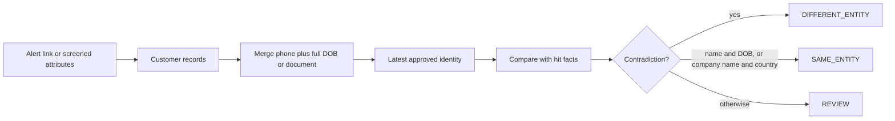

# Same person or not?

Sanctions-screening identity resolver for Diligent Track 2. For every watchlist hit, decide whether it is the customer.

Read [PRINCIPLES.md](PRINCIPLES.md) before changing the rules. Agents should also read [AGENTS.md](AGENTS.md). How the files behave is in [DATA_NOTES.md](DATA_NOTES.md). The engine write-up, diagram, and three cases are in [system/README.md](system/README.md).

## Run

```bash
system/run <data_dir> <output_file>
python3 validate.py --data <data_dir> --output <output_file> --score <data_dir>/practice_labels.jsonl
```

`data_dir` is the official room (`alerts.jsonl`, `hits.jsonl`, `customers.jsonl`, `accounts.jsonl`, `onboarding.jsonl`, `kyc_checks.jsonl`, `notes.jsonl`, `search_results.jsonl`, `name_variants.json`). The committed predictions are `output/dev.jsonl`. Do not commit `dev/` or API keys.

Python 3 standard library only. No model is required. A full development run is about 4 seconds. If a key is present, `OPENROUTER_API_KEY` is used first and `XAI_API_KEY` otherwise; neither key is read from the repo, and a missing key or an error stays on the rules.

## Practice score

`validate.py` on the 50 practice labels, two identical runs:

| Check | Result |
|---|---|
| Schema problems | 0 (819 hits) |
| Right decisions | 50 / 50 |
| Unsafe clearances | 0 |
| Decision score | 100.0 |
| Reason code, given the right decision | 100% |
| Customer record, given the right decision | 100% |
| Evidence set against the practice labels | 50 / 50 |
| Repeat run | byte-identical |

The decision score is the share of cost saved against sending every hit to review. Clearing a true `SAME_ENTITY` or `REVIEW` costs 60, so the engine clears only on an explicit SOP contradiction.



## Decisions in short

1. Find the customer from the account, login, or email, or from the screened name, date, country, and city.
2. Build one person from records that share a phone and a full date of birth, or an approved document number.
3. Take the legal name, date of birth, and document country from the latest approved check or identity note.
4. Read the hit's dates from `dobs`, then an age in the first paragraph, then a search result about this listing.
5. Clear on type, death, age under 16, date of birth, verified name, or location. Confirm a person on name and date of birth, or a company on name and country. Otherwise review.

Three worked hits (`H-D861DA` cleared on date of birth, `H-582410` confirmed, `H-FF3096` left for review) are written up in [system/README.md](system/README.md).
