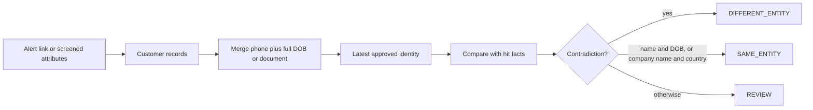

# Same person or not?

Sanctions-screening identity resolver for Diligent Track 2. For every watchlist hit, decide whether it is the customer.

Read [PRINCIPLES.md](PRINCIPLES.md) before changing the rules. Agents should also read [AGENTS.md](AGENTS.md). How the files behave is in [DATA_NOTES.md](DATA_NOTES.md). The engine write-up, diagram, and three cases are in [system/README.md](system/README.md).

## Quick start

`dev/` is the data room. It is not in git.

```bash
system/run dev output/dev.jsonl
```

Writes one decision line per hit. A run of this room printed:

```text
wrote 819 hits in 4.5s DIFFERENT=457 SAME=124 REVIEW=238
```

```bash
python3 validate.py --data dev --output output/dev.jsonl --score dev/practice_labels.jsonl
```

Checks the file shape and scores the 50 practice labels. This file printed:

```text
819 lines read, 0 problems
practice labels: 50 hits, 50 right decisions, 0 unsafe clearances
decision score 100.0 (0 = all REVIEW, 100 = perfect)
on right decisions: reason code 100%, customer record 100%
```

```bash
python3 ui/serve.py dev output/dev.jsonl   # opens http://127.0.0.1:8765/
```

Displays that file and does not score or rewrite it. The process prints `screening desk on http://127.0.0.1:8765`. The page opens on the workflow: alert, customer found, identity, comparison, and the decision. A funnel above it counts hits, customers found, cleared, kept open, and sent to review from the output file. The compare stage shows the list name with the original script beside it when the file has one. Cited record ids in the reason are shown as source chips. Simple and Detailed stay on the same page.

### Try these hits

Open `http://127.0.0.1:8765/?hit=H-2808BE` (or the other ids). The one-line reason is the sentence in `output/dev.jsonl`.

| Hit | Result | Reason |
|---|---|---|
| `H-2808BE` | Cleared | Verified name CHINEDU AZEEZ (KYC-20EE17, approved 2023-07-23) does not match list name Ridwan, Azeez (H-2808BE primary_name). |
| `H-80B4B5` | Kept open | DOB 1977-01-11 (NOTE-23FC8E, approved 2025-02-02) agrees with hit DOB 1976 or 1977 (SR-01BFC3 snippet); name agrees with Jérôme Kerviel (H-80B4B5 primary_name). |
| `H-FF3096` | Review | Customer DOB 1965-05-19 (NOTE-588201, approved 2024-10-06) cannot be compared: hit DOB is not on the list entry (H-FF3096 dobs). |
| `H-B47A06` | Review, original script on the list name | Arabic alias غاريث وين (H-B47A06 aliases) may transliterate to Gareth Wyn; verified name Gareth Wyn Llewellyn (KYC-091221, approved 2025-03-28), so not cleared on name. |

## Run

```bash
system/run <data_dir> <output_file>
python3 validate.py --data <data_dir> --output <output_file> --score <data_dir>/practice_labels.jsonl
python3 ui/serve.py <data_dir> <output_file>
```

`data_dir` is the official room (`alerts.jsonl`, `hits.jsonl`, `customers.jsonl`, `accounts.jsonl`, `onboarding.jsonl`, `kyc_checks.jsonl`, `notes.jsonl`, `search_results.jsonl`, `name_variants.json`). The committed predictions are `output/dev.jsonl`. Do not commit `dev/` or API keys.

Python 3 standard library only. No model is required. A full development run is about 4 seconds. If a key is present, `OPENROUTER_API_KEY` is used first (`typesafe/jev-router`) and `XAI_API_KEY` otherwise (`grok-4.3`). The model may only send a clearance back to review. It cannot create a decision, calls are capped at 120 or 10 minutes, and a missing key or an error stays on the rules. Neither key is read from the repo.

Copy `.env.example` to `.env` and fill in the blanks. `system/run` loads `.env` without overriding variables already set, and it never prints those values.

## Practice score

`validate.py` on the 50 practice labels, two identical runs:

| Check | Result |
|---|---|
| Schema problems | 0 (819 hits) |
| Right decisions | 50 / 50 |
| Unsafe clearances | 0 |
| Decision score | 100.0 |
| Reason code, given the right decision | 100% |
| Customer record, given the right decision | 100% |
| Evidence set against the practice labels | 50 / 50 |
| Repeat run | byte-identical, five times, with no API key |
| All 819 hits | 457 cleared, 124 kept open, 238 left for review |

The decision score is the share of cost saved against sending every hit to review. Clearing a true `SAME_ENTITY` or `REVIEW` costs 60, so the engine clears only on an explicit SOP contradiction. A support note that names the hit's country blocks a location clear. A same-year month or day clash on an unverified customer date, a 1 January hit date, or a day/month swap is left for review.

Names are normalised with Unicode NFKC, casefold, and diacritics removed, then a fixed Cyrillic, Greek, and Arabic transliteration. `name_variants.json` and a few built-in spellings (Mohammed/Muhammad, Yusuf/Youssef, Aleksandr/Alexander) apply. Particles and honorifics such as al-, bin, van, von, and Sheikh are not name parts. CJK is compared as written and is never romanised. A script match can confirm or block a clear. It cannot create one. `python3 system/test_normalize.py` checks the normaliser.



## Decisions in short

1. Find the customer from the account, login, or email, or from the screened name, date, country, and city.
2. Build one person from records that share a phone and a full date of birth, or an approved document number.
3. Take the legal name, date of birth, and document country from the latest approved check or identity note.
4. Read the hit's dates from `dobs`, then an age in the first paragraph, then a search result about this listing.
5. Clear on type, death, age under 16, date of birth, verified name, or location. Confirm a person on name and date of birth, or a company on name and country. Otherwise review.

Three worked hits (`H-D861DA` cleared on date of birth, `H-582410` confirmed, `H-FF3096` left for review) are written up in [system/README.md](system/README.md).
