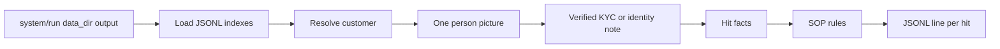

# Identity resolver

Deterministic SOP engine for watchlist hits. Decisions are deterministic rules only; no model decides. Grok writes the reason wording, checked against the record. See `PRINCIPLES.md`.

## Architecture



Customer resolution follows the link on the alert. Joint holders are picked with the screened name and date of birth. Records merge on phone plus full date of birth, or on the same approved document number. The latest approved check, including an identity note, supplies the legal name, date of birth, and document country. A note that says the check was rejected, failed, or expired is not that check. Every country named in the person's other notes counts as a customer country and can block a location clear; it cannot create one. Hit dates include `born on 30 June 1969`, `born in 1966`, `then 37`, `reached 37 years of age by`, and `aged forty-five`.

Hit dates come from `dobs`, otherwise an age in the first paragraph of the profile, otherwise a search result that names the same listing type and a country tied to the hit. Dated reports are only `According to …; Month D, YYYY:` lines.

Names are compared after NFKC, casefold, and stripping diacritics. Cyrillic, Greek, and Arabic are transliterated with a fixed table; CJK is kept exactly and never romanised. A transliteration may confirm a person or stop a `NAME_MISMATCH` clear. It is not a reason to clear.

The rules then clear on a contradiction (type, death, age under 16, date of birth, verified name, or location), confirm a person on name plus date of birth, or a company on name plus country, and leave everything else as `REVIEW`. A country clash does not clear a hit whose name and date already agree.

**evidence = the records that decided the hit, never the hit itself.** Every reason should name those records and the fact each gave. A reason is 2–4 sentences. Output order is `hit_id`. Sets are sorted before they affect a choice, so two runs write the same file.

## How to run

```bash
system/run dev output/dev.jsonl
python3 validate.py --data dev --output output/dev.jsonl --score dev/practice_labels.jsonl
```

Python 3 standard library only. A development run of 819 hits takes about 4 seconds. Decisions are deterministic rules only; no model decides. Grok writes the reason wording, checked against the record. The run does not use the network.

## Three cases

**Clear mismatch, `H-D861DA`.** Michael Earl Tilley was screened against `Tilley, Michael Earl`. The identity note `NOTE-8548C1` gives the customer date of birth 1979-11-08. The hit has no `dobs` field. The first paragraph of the profile says he was 46 when questioned in January 2023, so the listed person was born in 1976 or 1977. Every one of those years is more than a year away from 1979, which is `DOB_MISMATCH`. Evidence: `NOTE-8548C1`.

**Match, `H-582410`.** Elvira Velasco Morillo shares account `ACC-C4CA34` with another holder. The screened name and date of birth select `CUS-377745`. Note `NOTE-14E25A` verifies the date 1968-03-05 and a Spanish passport. The profile's first paragraph says she was a 30-year-old in November 1998, so the hit was born in 1967 or 1968. The year agrees, both sides are Spain, and the name agrees, so the decision is `NAME_DOB_LOCATION_MATCH`. Evidence: `CUS-377745`, `NOTE-14E25A`.

**Left for review, `H-FF3096`.** Abdul Rahman Yasin matches the hit's name, and a note says the customer lived in the United States, which is the hit's country. The hit has no date of birth, no age in the first paragraph, and no qualifying search result, so the customer date cannot be compared. A listed date of birth for the hit would settle it. The decision is `REVIEW` / `INSUFFICIENT_DATA`. Evidence: `NOTE-10AEAB`.

## Why not just fuzzy match?

`python3 tools/compare_matchers.py` scores three matchers on the same room:

| Matcher | Right | Unsafe clears | Score |
|---|---|---|---|
| Our matcher | 50/50 | 0 | 100 |
| Plain fuzzy matcher (whole-name similarity ≥ 85%) | 47/50 | 3 | 0 |
| Without name variants | 50/50 | 0 | 100 |

The plain fuzzy matcher is one we built for comparison. It changes 145 of 819 decisions (mostly unsafe clears). Transliteration alone changes one hit (`H-B47A06`) when variants are off.

## Known limits

We leave a hit for review when the files do not settle it: no list date of birth, a same-year month/day clash on an unverified customer date, more than one person fitting the alert, or a country clash after name and date already agree. A bad clear costs far more than a review, so the engine prefers `REVIEW` over a guess.

