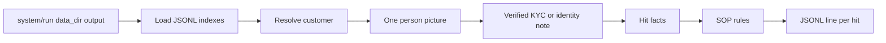

# Identity resolver

Deterministic SOP engine for watchlist hits. It does not need a model. With no `OPENROUTER_API_KEY` it never calls one. Jev (`typesafe/jev-router`) and Grok (`x-ai/grok-4.x`) are optional, cached, and cannot override a rule that already settled the hit. See `PRINCIPLES.md`.

## Architecture



Customer resolution follows the link on the alert. Joint holders are picked with the screened name and date of birth. Records merge on phone plus full date of birth, or on the same approved document number. The latest approved check, including an identity note, supplies the legal name, date of birth, and document country. A note that says the check was rejected, failed, or expired is not that check. Every country named in the person's other notes counts as a customer country and can block a location clear; it cannot create one. Hit dates include `born on 30 June 1969`, `born in 1966`, `then 37`, `reached 37 years of age by`, and `aged forty-five`.

Hit dates come from `dobs`, otherwise an age in the first paragraph of the profile, otherwise a search result that names the same listing type and a country tied to the hit. Dated reports are only `According to …; Month D, YYYY:` lines.

The rules then clear on a contradiction (type, death, age under 16, date of birth, verified name, or location), confirm a person on name plus date of birth, or a company on name plus country, and leave everything else as `REVIEW`. A country clash does not clear a hit whose name and date already agree.

Evidence is the ids of the records that decided the hit. Output order is `hit_id`. Sets are sorted before they affect a choice, so two runs write the same file.

## How to run

```bash
system/run dev output/dev.jsonl
python3 validate.py --data dev --output output/dev.jsonl --score dev/practice_labels.jsonl
```

Python 3 standard library only. A development run of 819 hits takes about 4 seconds and does not call a network. No model spend on that path.

## Three cases

**Clear mismatch, `H-D861DA`.** Michael Earl Tilley was screened against `Tilley, Michael Earl`. The identity note `NOTE-8548C1` gives the customer date of birth 1979-11-08. The hit has no `dobs` field. The first paragraph of the profile says he was 46 when questioned in January 2023, so the listed person was born in 1976 or 1977. Every one of those years is more than a year away from 1979, which is `DOB_MISMATCH`. The note is the only cited record.

**Match, `H-582410`.** Elvira Velasco Morillo shares account `ACC-C4CA34` with another holder. The screened name and date of birth select `CUS-377745`. Note `NOTE-14E25A` verifies the date 1968-03-05 and a Spanish passport. The profile's first paragraph says she was a 30-year-old in November 1998, so the hit was born in 1967 or 1968. The year agrees, both sides are Spain, and the name agrees, so the decision is `NAME_DOB_LOCATION_MATCH`.

**Left for review, `H-FF3096`.** Abdul Rahman Yasin matches the hit's name, and a note says the customer lived in the United States, which is the hit's country. The hit has no date of birth, no age in the first paragraph, and no qualifying search result, so the customer date cannot be compared. A listed date of birth for the hit would settle it. The decision is `REVIEW` / `INSUFFICIENT_DATA`, citing only `NOTE-10AEAB`. The customer record's Australia residence is not cited, because that country is not what decided the hit.

## Models

With no API key the run is the rules above and does not touch the network. `system/llm.py` is optional. `OPENROUTER_API_KEY` uses `https://openrouter.ai/api/v1` and the pinned id `typesafe/jev-router`. Otherwise `XAI_API_KEY` uses `https://api.x.ai/v1` and the pinned id `grok-4.3`. The model may only object to a clearance, and only with a verbatim quote and confidence of at least 60/63. It cannot create `DIFFERENT_ENTITY` or `SAME_ENTITY`, and it does not supply birth years. Seed is 1. Each call waits at most 8 seconds, and the run stops after 120 calls or 10 minutes. A missing key, an error, or an exhausted budget leaves the rules in place. Reason wording changes only when `RESOLVE_POLISH_REASONS=1`, and it cannot change the decision or the reason code. Calls are temperature 0 and cached by request hash under `system/.llm-cache/`, which is not committed. Keys stay in the environment.
